```mermaid
flowchart TD
    subgraph Point 1: Dual-Layer Multi-Selector Engine
        A1[Target Composer / Page] --> B1{Has data-testid?}
        B1 -- Yes (Legacy React) --> C1[Use data-testid Selectors]
        B1 -- No (Modern Base UI) --> D1[Use Semantic & Tailwind Selectors]
        C1 --> E1[Extract Tweet Text & Author]
        D1 --> E1
        E1 --> F1[Inject Split Buttons Below Composer]
    end

    subgraph Point 2: Resilient Fallback Cascade
        G1[User Action / Prompt] --> H1[Cloud API: Gemini 3.5 Flash-Lite]
        H1 -- Fail / Quota / Net --> I1{Gemini Nano Ready?}
        I1 -- Yes --> J1[Gemini Nano Local AI]
        I1 -- No / Fail --> K1{Headless Token Valid?}
        K1 -- Yes --> L1[Headless Cookie Request]
        K1 -- No / Fail --> M1[Gemini Web Tab Automation]
    end

    subgraph Point 3: Synthetic State Sync
        N1[Text Generated] --> O1[Range Clear + Synthetic Paste]
        O1 --> P1[InputEvent: beforeinput insertText]
        P1 --> Q1[Draft.js / Lexical State Updated]
        Q1 --> R1[X Post / Reply Button Enabled]
    end

    subgraph Point 4 & 5: Auth & Web Intent
        S1[Gemini Auth Check] --> T1[Strict !explicitSignIn Guard]
        U1[Popup Post Creator] --> V1[x.com/intent/post Web Intent]
    end
```

# Implementation Plan: Twitter (𝕏) AI Assistant Architectural Fix Strategy

**Target Project:** `twitter-auto-reply` (`project2`)  
**Target Version:** `1.3.3`  
**Scope:** Complete implementation plan for all 5 points of the Architectural Fix Strategy identified during the in-depth audit.

---

## Executive Summary & Objectives

The recent frontend overhaul of **[x.com](https://x.com)** has migrated the platform to a modern **Base UI + Tailwind architecture** (`group/post`, `x-link`, `x-avatar`, `div[dir="auto"]`), completely removing production `data-testid` attributes (`totalTestIds: 0`). Consequently, the extension's in-page buttons fail to inject, tweet context extraction returns empty data, and composer mode detection misidentifies replies as new posts. Additionally, architectural flaws in `background.js` (truncated fallback cascade), `content_gemini.js` (false-positive auth detection), and `popup/popup.js` (deprecated compose route) degrade reliability.

This implementation plan resolves all 5 critical points, restoring 100% functionality while ensuring future resilience across both modern and legacy X web interfaces.

---



---

## Point 1: Dual-Layer Multi-Selector Architecture for Twitter/X

### Objective
Replace fragile, single-point-of-failure `data-testid` queries in `content_twitter.js` with resilient, prioritized multi-selector chains and dedicated extractor helper functions that seamlessly support both the modern Base UI/Tailwind DOM and legacy React DOMs.

### Affected File
- [`content_twitter.js`](file:///d:/5.%20Work/2.%20Antigravity/project2/content_twitter.js)

### Detailed Implementation Specifications

#### 1.1 Centralized Multi-Selector Constants
Define reusable selector fallback groups at the top of `content_twitter.js`:
```javascript
const SELECTORS = {
  // Tweet Articles (Modern Base UI + Legacy React)
  tweetArticle: 'article[data-testid="tweet"], article.group\\/post, article[role="article"], article',
  
  // Tweet Text Containers
  tweetText: 'div[data-testid="tweetText"], [data-testid="tweetText"], div[dir="auto"][class*="whitespace-pre-wrap"], div[dir="auto"]',
  
  // User & Author Handle
  userName: 'div[data-testid="User-Name"], [data-testid="User-Name"]',
  
  // Toolbars (Below Draft.js / Lexical Editor)
  toolbar: 'div[data-testid="toolBar"], [role="toolbar"], div[class*="toolbar"]',
  
  // Tweet Submit Buttons (Inline Reply & Modal Post)
  tweetButton: '[data-testid="tweetButtonInline"], [data-testid="tweetButton"], button[data-testid*="tweetButton"]',
  
  // Contenteditable Editors
  editor: 'div[data-testid^="tweetTextarea_"][role="textbox"], div[role="textbox"][contenteditable="true"], div[contenteditable="true"][role="textbox"], div[contenteditable="true"]',
  
  // Sidebar New Post Button
  composeNavBtn: 'a[data-testid="SideNav_NewTweet_Button"], div[data-testid="SideNav_NewTweet_Button"], a[href="/compose/post"], a[href="/compose/tweet"]'
};
```

#### 1.2 Dedicated Author Handle Extractor (`extractAuthorHandle`)
Enhance author extraction to handle both legacy `data-testid="User-Name"` blocks and modern Base UI user links:
```javascript
function extractAuthorHandle(containerEl) {
  if (!containerEl) return '';

  // Strategy A: If explicit User-Name element passed
  const explicitText = containerEl.innerText || '';
  const match = explicitText.match(/@([A-Za-z0-9_]+)/);
  if (match) return match[1];

  // Strategy B: Search links or spans inside container for @handle
  const handleEl = Array.from(containerEl.querySelectorAll('a[href^="/"], span')).find(el => {
    const txt = (el.innerText || '').trim();
    return txt.startsWith('@') && /^@[A-Za-z0-9_]+$/.test(txt);
  });
  if (handleEl) return handleEl.innerText.trim().replace(/^@/, '');

  // Strategy C: Parse root profile link href (e.g. href="/Google")
  const userLink = containerEl.querySelector('a[href^="/"][data-status="active"], a[href^="/"][role="link"], a[href^="/"]');
  if (userLink) {
    const href = userLink.getAttribute('href') || '';
    const linkMatch = href.match(/^\/([A-Za-z0-9_]+)$/);
    if (linkMatch && !['home', 'explore', 'notifications', 'messages', 'i'].includes(linkMatch[1].toLowerCase())) {
      return linkMatch[1];
    }
  }

  return '';
}
```

#### 1.3 Context Extractor Upgrade (`extractTweetContext`)
Update lines 75–142 to search using the resilient selector cascade:
1. **Modal Dialog:** `modal.querySelectorAll(SELECTORS.tweetArticle)`
2. **Inline Reply:** `composerEl.closest(SELECTORS.tweetArticle)`
3. **Preceding Siblings:** Walk upward and check `prev.matches(SELECTORS.tweetArticle)` or `prev.querySelectorAll(SELECTORS.tweetArticle)`
4. **Focal Status Tweet:** `document.querySelector('article[tabindex="-1"], article')`
5. **Text Extraction:** Query `targetTweet.querySelector(SELECTORS.tweetText)` with fallback to text-bearing `div[dir="auto"]`.

#### 1.4 Button Injection Upgrade (`injectGeminiButtons`)
Update lines 750–787 to locate toolbars via both semantic and structural selectors:
```javascript
function injectGeminiButtons() {
  // Query standard toolbars or parent containers containing submit buttons
  let toolbars = Array.from(document.querySelectorAll(SELECTORS.toolbar));

  // Fallback: Find submit buttons directly and use their parent flex row as toolbar
  if (toolbars.length === 0) {
    const submitButtons = document.querySelectorAll(SELECTORS.tweetButton);
    submitButtons.forEach(btn => {
      const parentRow = btn.closest('div.flex, div[class*="flex"], div');
      if (parentRow && !toolbars.includes(parentRow)) {
        toolbars.push(parentRow);
      }
    });
  }

  toolbars.forEach(toolbar => {
    if (toolbar.closest('#gemini-floating-hud')) return;
    const existingWrapper = toolbar.querySelector('.gemini-reply-wrapper');
    const currentMode = detectComposerType(toolbar);

    if (existingWrapper) {
      if (existingWrapper.dataset.composerMode === currentMode) return;
      existingWrapper.replaceWith(createGeminiReplyElement(toolbar));
      return;
    }

    toolbar.setAttribute('data-gemini-injected', 'true');
    const tweetButton = toolbar.querySelector(SELECTORS.tweetButton) ||
      Array.from(toolbar.querySelectorAll('button')).find(b => /(?:post|reply)/i.test(b.innerText || ''));

    const geminiElement = createGeminiReplyElement(toolbar);
    if (tweetButton && tweetButton.parentElement) {
      tweetButton.parentElement.insertBefore(geminiElement, tweetButton);
    } else {
      toolbar.appendChild(geminiElement);
    }
  });
}
```

#### 1.5 Composer Mode Detection Fix (`detectComposerType`)
Update lines 337–365 to use `SELECTORS.tweetArticle` so reply dialogs are correctly tagged as `'reply'` instead of erroneously falling back to `'new_post'`.

---

## Point 2: Complete the Multi-Tier Fallback Cascade in `background.js`

### Objective
Restore the broken multi-engine fallback cascade so failures in `cloud_api` gracefully roll down to Nano, Headless Web, and Gemini Web Tab rather than aborting prematurely.

### Affected File
- [`background.js`](file:///d:/5.%20Work/2.%20Antigravity/project2/background.js)

### Detailed Implementation Specifications

#### 2.1 Complete `cloud_api` Fallback Chain
Replace lines 861–874 of `executeWithFallback`:
```javascript
if (engine === 'cloud_api') {
  // 1. Try local Gemini Nano if available & ready
  try {
    const nanoStatus = await checkNanoStatus();
    if (nanoStatus.available && nanoStatus.isReady !== false) {
      console.log('[Background] Cloud API failed, falling back to local Gemini Nano.');
      const reply = await generateViaNano(promptText, customInstructions, mode);
      return { reply, engine: 'Gemini Nano (fallback)' };
    }
  } catch (nanoErr) {
    console.warn('[Background] Fallback to Gemini Nano failed:', nanoErr);
  }

  // 2. Try silent Headless Web request with Google cookies
  try {
    console.log('[Background] Cloud API failed, attempting silent Headless fallback.');
    const reply = await generateViaHeadless(promptText);
    return { reply, engine: 'Headless Web (fallback)' };
  } catch (headlessErr) {
    console.warn('[Background] Silent Headless fallback failed:', headlessErr);
  }

  // 3. Try Gemini Web Tab automation
  const existingTab = await findGeminiTab();
  if (existingTab) {
    try {
      console.log('[Background] Cloud API failed, falling back to existing Gemini Web Tab.');
      const reply = await generateViaWebTab(promptText);
      return { reply, engine: 'Gemini Web Tab (fallback)' };
    } catch (tabErr) {
      console.warn('[Background] Web Tab fallback failed:', tabErr);
    }
  }

  throw primaryErr;
}
```

#### 2.2 Thinking Model Output Token Protection
In `generateViaCloudAPI` (lines 213–216):
- Ensure `maxOutputTokens` provides adequate headroom (minimum 512 tokens) when calling reasoning models (e.g. `gemini-2.5-pro` or hybrid models), preventing thoughts from consuming all available tokens and yielding empty text strings.

---

## Point 3: Robust Input Event Emulation for React 18 / Lexical / Draft.js

### Objective
Ensure that inserted text instantly updates Twitter's internal React 18 / Draft.js / Lexical state, updating the character counter and immediately enabling the "Post" / "Reply" submit button without requiring manual keystrokes.

### Affected File
- [`content_twitter.js`](file:///d:/5.%20Work/2.%20Antigravity/project2/content_twitter.js) (Lines 172–249)

### Detailed Implementation Specifications

#### 3.1 Dual-Phase Event Emulation in `insertTextIntoEditor`
```javascript
async function insertTextIntoEditor(editor, text) {
  if (!editor || !text) return false;

  const currentContent = (editor.innerText || editor.textContent || '').trim();
  if (currentContent === text.trim()) return true;

  editor.focus();

  // Step 1: Select existing contents
  if (currentContent.length > 0) {
    try {
      const sel = window.getSelection();
      if (sel) {
        const range = document.createRange();
        range.selectNodeContents(editor);
        sel.removeAllRanges();
        sel.addRange(range);
        document.dispatchEvent(new Event('selectionchange'));
      }
      document.execCommand('selectAll', false, null);
    } catch (e) {}

    await new Promise(r => setTimeout(r, 20));

    // Dispatch beforeinput delete
    try {
      editor.dispatchEvent(new InputEvent('beforeinput', {
        bubbles: true,
        cancelable: true,
        inputType: 'deleteContentBackward'
      }));
      document.execCommand('delete', false, null);
    } catch (e) {}

    await new Promise(r => setTimeout(r, 20));
  }

  // Step 2: Dispatch beforeinput with insertText for modern Lexical/Draft.js
  try {
    editor.dispatchEvent(new InputEvent('beforeinput', {
      bubbles: true,
      cancelable: true,
      inputType: 'insertText',
      data: text
    }));
  } catch (e) {}

  // Step 3: Dispatch synthetic paste event
  try {
    const dt = new DataTransfer();
    dt.setData('text/plain', text);
    editor.dispatchEvent(new ClipboardEvent('paste', {
      bubbles: true,
      cancelable: true,
      clipboardData: dt
    }));
  } catch (e) {}

  await new Promise(r => setTimeout(r, 30));

  // Step 4: Fallback to document.execCommand if text not yet present
  let updatedContent = (editor.innerText || editor.textContent || '').trim();
  const textSample = text.trim().substring(0, Math.min(20, text.trim().length));
  if (!updatedContent || !updatedContent.includes(textSample)) {
    try {
      document.execCommand('insertText', false, text);
    } catch (e) {}
    await new Promise(r => setTimeout(r, 20));
  }

  // Step 5: Dispatch input and change events for React state reconciliation
  editor.dispatchEvent(new InputEvent('input', { bubbles: true, inputType: 'insertText', data: text }));
  editor.dispatchEvent(new Event('input', { bubbles: true }));
  editor.dispatchEvent(new Event('change', { bubbles: true }));

  // Step 6: Move cursor cleanly to end
  setTimeout(() => {
    try {
      editor.focus();
      const sel = window.getSelection();
      if (sel) {
        const range = document.createRange();
        range.selectNodeContents(editor);
        range.collapse(false);
        sel.removeAllRanges();
        sel.addRange(range);
        document.dispatchEvent(new Event('selectionchange'));
      }
    } catch (e) {}
  }, 40);

  return true;
}
```

---

## Point 4: Fix Login Status Check in `content_gemini.js`

### Objective
Eliminate the false-positive authentication check on `gemini.google.com/app` that causes 45-second hanging timeouts when users are logged out.

### Affected File
- [`content_gemini.js`](file:///d:/5.%20Work/2.%20Antigravity/project2/content_gemini.js) (Lines 109–128)

### Detailed Implementation Specifications

#### 4.1 Strict Authentication Guard in `checkLoginStatus`
```javascript
function checkLoginStatus() {
  const url = window.location.href;
  const isApp = url.includes('/app');
  const inputEl = findInputElement();
  const richTextarea = document.querySelector('rich-textarea');
  const chatWindow = document.querySelector('chat-window, bard-sidenav, chat-history, [aria-label*="Chat history" i], [aria-label*="Recent chats" i]');
  const newChatBtn = document.querySelector('button[aria-label*="New chat" i], [data-test-id*="new-chat"]');

  // Explicit sign-in cues
  const explicitSignIn = document.querySelector(
    'a[href*="ServiceLogin"], a[href*="/signin"], button[aria-label*="Sign in" i], [data-test-id="sign-in-button"]'
  );

  // User profile / avatar indicating authenticated session
  const userAvatar = document.querySelector('a[aria-label*="Google Account" i], img[alt*="Google Account" i], .gb_d[aria-expanded]');

  // Must have chat UI AND must NOT have an explicit sign-in prompt
  const hasChatUI = !!(inputEl || richTextarea || chatWindow || newChatBtn);
  const isLoggedIn = (hasChatUI && !explicitSignIn) || !!userAvatar;

  return {
    loggedIn: isLoggedIn,
    hasInput: !!inputEl || !!richTextarea,
    hasChatUI: hasChatUI,
    hasExplicitSignIn: !!explicitSignIn,
    url: url,
    isApp: isApp
  };
}
```

---

## Point 5: Fix Web Intent URL in `popup/popup.js`

### Objective
Update the standalone Post Creator's "Post on X" launcher to use the official, standardized Twitter/X Web Intent endpoint so pre-filled draft text is never discarded or stripped during navigation and login redirects.

### Affected File
- [`popup/popup.js`](file:///d:/5.%20Work/2.%20Antigravity/project2/popup/popup.js) (Lines 556–565)

### Detailed Implementation Specifications

#### 5.1 Web Intent Route Correction
```javascript
if (btnOpenXPost) {
  btnOpenXPost.addEventListener('click', () => {
    if (!postOutputText) return;
    const text = postOutputText.innerText.trim();
    if (!text) return;
    
    // Official Twitter / X Web Intent (preserves text through redirects and login)
    const url = `https://x.com/intent/post?text=${encodeURIComponent(text)}`;
    chrome.tabs.create({ url });
  });
}
```

---

## Testing & Verification Protocol

| Verification Step | Target Component | Success Criteria |
| :--- | :--- | :--- |
| **1. In-Page Injection** | `content_twitter.js` on `x.com/status/*` | "✦ AI Reply" and "✦ AI Post" buttons render in composers. |
| **2. Context Extraction** | `extractTweetContext()` | Extracted text and `@handle` match the tweet being viewed. |
| **3. Draft Insertion** | `insertTextIntoEditor()` | Text populates editor, char counter updates, and "Post" activates. |
| **4. Cloud API Fallback** | `executeWithFallback()` | With invalid key or offline API, cleanly cascades to Headless/Tab. |
| **5. Gemini Auth Guard** | `content_gemini.js` on signed-out page | Returns `loggedIn: false`, displays "Please log in to Gemini". |
| **6. Web Intent Redirect** | `popup/popup.js` "Post on X" button | Opens `https://x.com/intent/post?text=...` with text pre-filled. |

---

*End of Implementation Plan.*

